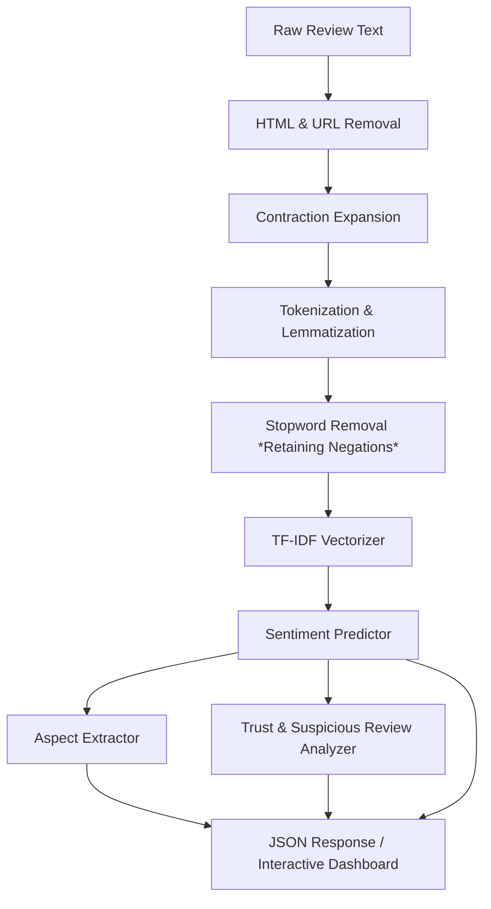

# ReviewLens AI

ReviewLens AI is a comprehensive, full-stack web application designed for sentiment analysis and aspect-based review insight extraction from product reviews. Built as an end-to-end system, it integrates a machine learning pipeline with a FastAPI backend and a responsive Next.js 16 frontend. The application focuses on model reliability, uncertainty flagging, aspect extraction, and review trust analysis, making it a powerful tool for understanding customer feedback in depth.

By analyzing customer reviews, the platform extracts underlying sentiments, evaluates specific product features (aspects), calculates a heuristic trust score to filter potential spam, and flags low-confidence predictions.

---

## 🌟 Key Features

* **Multi-Model Sentiment Classification**: Includes Multinomial Naive Bayes and Logistic Regression models trained on Amazon product reviews, with an optional calibrated linear SVM (`python ml/train.py --with-svm`).
* **Uncertainty & Reliability Flagging**: Estimates prediction confidence and classifies outcomes into High, Medium, and Low reliability tiers, flagging low-confidence results.
* **Aspect-Based Sentiment Extraction**: Extracts mentions of specific product aspects (e.g., battery, sound, comfort, build quality, connectivity, delivery, price, microphone) and determines sentiment on a sentence-by-sentence basis.
* **Review Trust Analysis**: Evaluates the integrity of reviews using heuristic rules to apply penalties for suspicious patterns (caps shouting, word repetition, excessive exclamation marks, and short length).
* **Interactive Dashboards**: Features a user-friendly single-review analyzer and a batch CSV processing interface complete with charts and lists of top compliments and complaints.

---

## 🏗️ System Architecture & Data Pipeline

When a user submits a review, the text is preprocessed and vectorized using TF-IDF before passing through the prediction models:



---

## 🛠️ Tech Stack

| Component | Technology | Version | Purpose |
| :--- | :--- | :--- | :--- |
| **Backend Framework** | FastAPI | `0.111.0` | High-performance asynchronous REST API |
| **Backend Server** | Uvicorn | `0.29.0` | ASGI server implementation |
| **Machine Learning** | scikit-learn | `1.9.0` | ML modeling (Naive Bayes, Logistic Regression) |
| **Data Processing** | pandas | `2.2.2` | Data manipulation and preprocessing |
| **Data Processing** | numpy | `1.26.4` | Numerical array operations |
| **NLP Library** | NLTK | `3.8.1` | Tokenization, stopwords, lemmatization |
| **Frontend Framework** | Next.js (App Router) | `16.x` | Modern React framework |
| **Styling** | Tailwind CSS | `v3` | Utility-first CSS styling |
| **Visualizations** | Recharts | `Latest` | Interactive data charts and graphs |

---

## 📖 Project Documentation

For step-by-step guides and detailed reference manuals, please refer to the following files:

* **[User Guide](docs/user-guide.md)**: Details on navigating the Next.js web application, analyzing reviews, uploading batch CSVs, understanding trust penalties (length, exclamation, shouting, repetition), and review examples.
* **[Developer Setup & ML Guide](docs/developer-guide.md)**: Comprehensive guide to setting up and running backend/frontend development servers locally, dataset characteristics, NLP cleaning steps, training pipeline execution, and model failure modes.
* **[API Reference](docs/api-reference.md)**: Full endpoint reference for `/predict`, `/batch`, and `/stats`, detailing JSON payloads, parameter schemas, and error responses.
* **[Demo Video Scripts](docs/demo-scripts.md)**: Timecoded, speaker-prompted, two-part video scripts for recording end-user walkthroughs and developer setup walkthroughs.

---

## 🚀 Quick Start (Development Mode)

### 1. Start the Backend API
Navigate to `/backend` directory, activate virtual environment, and run:
```bash
cd backend
source .venv/bin/activate
PYTHONPATH=. uvicorn main:app --reload --port 8000
```
Interactive API docs are available at [http://localhost:8000/docs](http://localhost:8000/docs).

### 2. Start the Frontend App
Navigate to `/frontend` directory and run:
```bash
cd frontend
npm install
npm run dev
```
The client UI will run on [http://localhost:3000](http://localhost:3000).

### Optional: the fine-tuned transformer
A fine-tuned DistilRoBERTa beat the TF-IDF models by 3.6 points of accuracy on a 200k-review Amazon sample (see `backend/experiments/results/hf-200k/report.md`). The API serves it as a third model when it is configured:
```bash
pip install -r backend/requirements-transformer.txt
TRANSFORMER_MODEL=/path/to/saved/model PYTHONPATH=. uvicorn main:app --port 8000
```
The model folder comes from `python -m experiments.run_experiment --save-model DIR` (see `backend/experiments/README.md`) and includes the calibration that makes its confidence meaningful. Without `TRANSFORMER_MODEL` the API serves the TF-IDF models only. Details are in `docs/api-reference.md`.

### 3. Run Test Suites
Verify that everything is set up correctly by running tests:
```bash
cd backend
PYTHONPATH=. .venv/bin/pytest
```

---

## 🤝 Contributing
Contributions are welcome! Please follow [PEP 8](https://peps.python.org/pep-0008/) style guidelines for Python code, run tests before submitting PRs, and make edits inside the appropriate directories (`backend` / `frontend`).

---

## 📄 License
This project is licensed under the MIT License.
