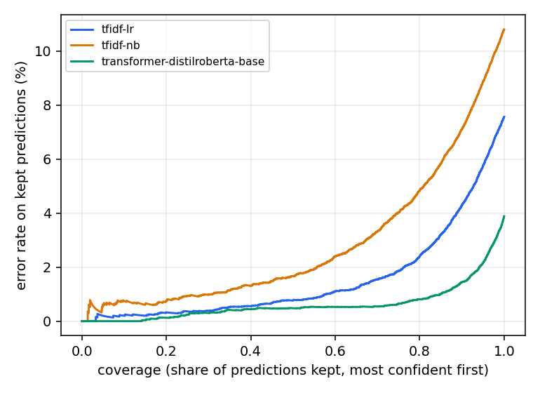
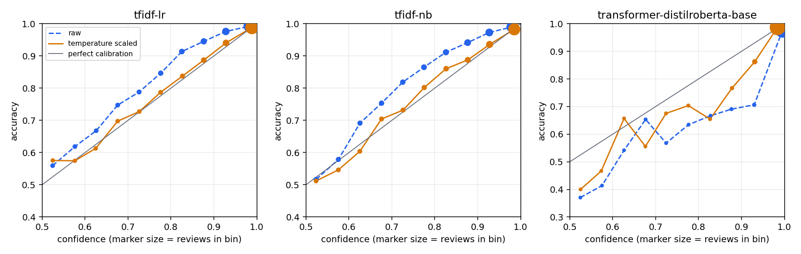

# Model comparison: hf data

Splits: train 159,980 / val 19,998 / test 19,998 (seed 42, fingerprint `5e9d4ef3679e`). Hyperparameters and the calibration temperature are fitted on validation only; all numbers below are on the held-out test split. Brackets are 95% bootstrap intervals.

> 200k-review Amazon polarity sample from the Hugging Face hub.

## Accuracy and calibration

| Model | Accuracy | F1 | AUC | NLL | Brier | ECE (raw) | ECE (scaled) | T |
| :-- | :-- | :-- | :-- | :-- | :-- | :-- | :-- | :-- |
| tfidf-lr | 0.9243 [0.9208, 0.9280] | 0.9239 | 0.9766 [0.9750, 0.9784] | 0.2052 | 0.0586 | 0.0354 [0.0324, 0.0389] | 0.0050 | 0.74 |
| tfidf-nb | 0.8920 [0.8879, 0.8960] | 0.8912 | 0.9585 [0.9561, 0.9608] | 0.2752 | 0.0812 | 0.0447 [0.0421, 0.0491] | 0.0096 | 0.72 |
| transformer-distilroberta-base | 0.9611 [0.9584, 0.9637] | 0.9610 | 0.9915 [0.9905, 0.9925] | 0.1374 | 0.0327 | 0.0252 [0.0231, 0.0278] | 0.0119 | 1.48 |

ECE is the expected calibration error over 10 equal-width confidence bins (lower is better). T is the temperature fitted on validation; T > 1 means the raw model was overconfident.

> **tfidf-lr** picked 2.0 at the edge of its search grid (2.0 to 128.0), so a better value may lie outside it and this baseline may be slightly under-tuned.

> **tfidf-nb** picked 0.1 at the edge of its search grid (0.1 to 3.0), so a better value may lie outside it and this baseline may be slightly under-tuned.

## Cost

| Model | Parameters | Train (s) | Test inference (s) | ms / review | Hardware |
| :-- | :-- | :-- | :-- | :-- | :-- |
| tfidf-lr | n/a | 50 | 2.5 | 0.13 | x86_64, 2 CPU threads, GPU Tesla T4 |
| tfidf-nb | n/a | 37 | 2.5 | 0.13 | x86_64, 2 CPU threads, GPU Tesla T4 |
| transformer-distilroberta-base | 82,119,938 | 1936 | 66.0 | 3.30 | x86_64, 2 CPU threads, GPU Tesla T4 |

Timings are wall-clock on the hardware shown, so they are only comparable between rows run on the same machine.

## Selective prediction (abstain on the least confident)

| Model | acc @ 100% | acc @ 90% | acc @ 80% | acc @ 70% | acc @ 50% | AURC |
| :-- | :-- | :-- | :-- | :-- | :-- | :-- |
| tfidf-lr | 92.43% | 95.72% | 97.60% | 98.46% | 99.23% | 0.0150 |
| tfidf-nb | 89.20% | 92.90% | 95.16% | 96.67% | 98.34% | 0.0283 |
| transformer-distilroberta-base | 96.11% | 98.56% | 99.19% | 99.46% | 99.52% | 0.0062 |

Temperature scaling is monotonic, so it cannot change which predictions rank as most confident; this table is identical before and after calibration. AURC is the area under the risk-coverage curve (lower is better).



## Do the API's reliability tiers mean something?

The API labels predictions HIGH (confidence >= 0.90), MEDIUM (>= 0.70) and LOW. Share of test reviews and accuracy inside each tier:

| Model | Calibration | HIGH share / acc | MEDIUM share / acc | LOW share / acc |
| :-- | :-- | :-- | :-- | :-- |
| tfidf-lr | raw | 63.7% / 98.8% | 24.2% / 89.2% | 12.1% / 65.1% |
| tfidf-lr | scaled | 74.8% / 98.1% | 16.3% / 82.9% | 8.9% / 61.8% |
| tfidf-nb | raw | 49.1% / 98.4% | 32.4% / 89.6% | 18.5% / 64.1% |
| tfidf-nb | scaled | 64.2% / 97.3% | 22.7% / 83.5% | 13.1% / 59.5% |
| transformer-distilroberta-base | raw | 96.5% / 97.4% | 2.3% / 65.4% | 1.2% / 50.6% |
| transformer-distilroberta-base | scaled | 94.1% / 98.0% | 4.1% / 71.4% | 1.8% / 53.1% |



## Pairwise comparison

Accuracy(A) - Accuracy(B) with a paired bootstrap interval, and an exact McNemar test on the reviews where exactly one model is right.

| A | B | Delta accuracy | only A right | only B right | McNemar p |
| :-- | :-- | :-- | :-- | :-- | :-- |
| tfidf-lr | tfidf-nb | 0.0324 [0.0287, 0.0359] | 1138 | 491 | 3.229e-59 |
| tfidf-lr | transformer-distilroberta-base | -0.0368 [-0.0402, -0.0332] | 287 | 1023 | 4.269e-97 |
| tfidf-nb | transformer-distilroberta-base | -0.0692 [-0.0733, -0.0647] | 313 | 1696 | 3.056e-229 |

## Setup

```json
{
  "tfidf-lr": {
    "preprocess": "raw",
    "max_features": 100000,
    "C": 2.0,
    "grid": [
      2.0,
      8.0,
      32.0,
      128.0
    ],
    "at_grid_edge": true,
    "val_accuracy_at_selection": 0.9252425242524253
  },
  "tfidf-nb": {
    "preprocess": "raw",
    "max_features": 100000,
    "alpha": 0.1,
    "grid": [
      0.1,
      0.3,
      1.0,
      3.0
    ],
    "at_grid_edge": true,
    "val_accuracy_at_selection": 0.8938393839383938
  },
  "transformer-distilroberta-base": {
    "model_name": "distilroberta-base",
    "max_length": 256,
    "batch_size": 32,
    "eval_batch_size": 128,
    "learning_rate": 2e-05,
    "epochs": 2,
    "warmup_ratio": 0.06,
    "weight_decay": 0.01,
    "max_grad_norm": 1.0,
    "seed": 42,
    "max_train_samples": null,
    "device": "cuda",
    "log_every": 100,
    "best_epoch": 2,
    "n_parameters": 82119938,
    "n_train_used": 159980
  }
}
```

Versions per model:

```json
{
  "tfidf-lr": {
    "python": "3.13.15",
    "scikit-learn": "1.6.1",
    "numpy": "2.1.3",
    "torch": "2.11.0+cu130",
    "transformers": "5.20.1"
  },
  "tfidf-nb": {
    "python": "3.13.15",
    "scikit-learn": "1.6.1",
    "numpy": "2.1.3",
    "torch": "2.11.0+cu130",
    "transformers": "5.20.1"
  },
  "transformer-distilroberta-base": {
    "python": "3.13.15",
    "scikit-learn": "1.6.1",
    "numpy": "2.1.3",
    "torch": "2.11.0+cu130",
    "transformers": "5.20.1"
  }
}
```

One training seed per model; no variance across seeds is reported.
