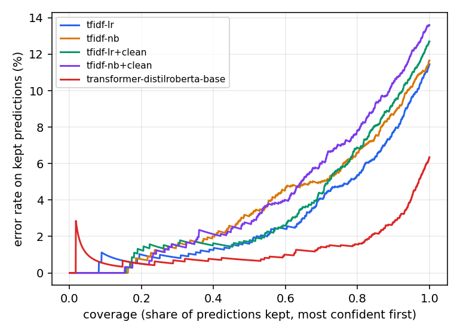
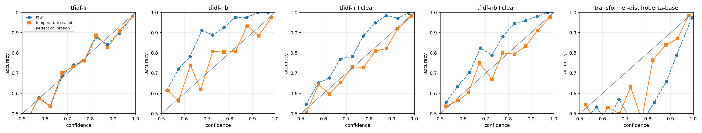

# Model comparison: local data

Splits: train 15,993 / val 2,000 / test 2,000 (seed 42, fingerprint `fbed469f9cc2`). Hyperparameters and the calibration temperature are fitted on validation only; all numbers below are on the held-out test split. Brackets are 95% bootstrap intervals.

> Development subset: 20k reviews from test_csvs/all_reviews_raw.csv, not the 1M-review training set. Use for pipeline validation, not for headline claims. '+clean' rows apply the production clean_review_text preprocessing (stopword removal, lemmatization); the others use raw text.

## Accuracy and calibration

| Model | Accuracy | F1 | AUC | NLL | Brier | ECE (raw) | ECE (scaled) | T |
| :-- | :-- | :-- | :-- | :-- | :-- | :-- | :-- | :-- |
| tfidf-lr | 0.8855 [0.8710, 0.9000] | 0.8865 | 0.9546 [0.9456, 0.9623] | 0.2754 | 0.0826 | 0.0179 [0.0149, 0.0340] | 0.0181 | 1.01 |
| tfidf-nb | 0.8835 [0.8695, 0.8980] | 0.8823 | 0.9450 [0.9349, 0.9544] | 0.3748 | 0.1112 | 0.1396 [0.1263, 0.1531] | 0.0321 | 0.40 |
| tfidf-lr+clean | 0.8730 [0.8585, 0.8880] | 0.8740 | 0.9466 [0.9370, 0.9551] | 0.3241 | 0.0972 | 0.0697 [0.0596, 0.0840] | 0.0154 | 0.55 |
| tfidf-nb+clean | 0.8640 [0.8480, 0.8785] | 0.8640 | 0.9363 [0.9252, 0.9463] | 0.3506 | 0.1063 | 0.0771 [0.0650, 0.0911] | 0.0204 | 0.54 |
| transformer-distilroberta-base | 0.9365 [0.9250, 0.9470] | 0.9373 | 0.9816 [0.9762, 0.9869] | 0.1939 | 0.0503 | 0.0372 [0.0289, 0.0486] | 0.0199 | 1.45 |

ECE is the expected calibration error over 10 equal-width confidence bins (lower is better). T is the temperature fitted on validation; T > 1 means the raw model was overconfident.

## Cost

| Model | Parameters | Train (s) | Test inference (s) | ms / review | Hardware |
| :-- | :-- | :-- | :-- | :-- | :-- |
| tfidf-lr | n/a | 5 | 0.2 | 0.12 | x86_64, 4 CPU threads, no GPU |
| tfidf-nb | n/a | 5 | 0.2 | 0.12 | x86_64, 4 CPU threads, no GPU |
| tfidf-lr+clean | n/a | 15 | 0.1 | 0.07 | x86_64, 4 CPU threads, no GPU |
| tfidf-nb+clean | n/a | 15 | 0.1 | 0.07 | x86_64, 4 CPU threads, no GPU |
| transformer-distilroberta-base | 82,119,938 | 195 | 7.2 | 3.58 | x86_64, 2 CPU threads, GPU Tesla T4 |

Timings are wall-clock on the hardware shown, so they are only comparable between rows run on the same machine.

## Selective prediction (abstain on the least confident)

| Model | acc @ 100% | acc @ 90% | acc @ 80% | acc @ 70% | acc @ 50% | AURC |
| :-- | :-- | :-- | :-- | :-- | :-- | :-- |
| tfidf-lr | 88.55% | 92.28% | 94.62% | 95.93% | 98.40% | 0.0303 |
| tfidf-nb | 88.35% | 91.33% | 93.38% | 95.00% | 96.80% | 0.0379 |
| tfidf-lr+clean | 87.30% | 90.67% | 93.12% | 95.64% | 98.20% | 0.0353 |
| tfidf-nb+clean | 86.40% | 89.56% | 92.19% | 94.00% | 97.30% | 0.0421 |
| transformer-distilroberta-base | 93.65% | 97.22% | 98.44% | 98.57% | 99.30% | 0.0133 |

Temperature scaling is monotonic, so it cannot change which predictions rank as most confident; this table is identical before and after calibration. AURC is the area under the risk-coverage curve (lower is better).



## Do the API's reliability tiers mean something?

The API labels predictions HIGH (confidence >= 0.90), MEDIUM (>= 0.70) and LOW. Share of test reviews and accuracy inside each tier:

| Model | Calibration | HIGH share / acc | MEDIUM share / acc | LOW share / acc |
| :-- | :-- | :-- | :-- | :-- |
| tfidf-lr | raw | 67.6% / 96.4% | 20.3% / 81.0% | 12.1% / 57.0% |
| tfidf-lr | scaled | 67.2% / 96.6% | 20.5% / 80.8% | 12.2% / 57.6% |
| tfidf-nb | raw | 12.8% / 100.0% | 50.0% / 94.0% | 37.3% / 76.8% |
| tfidf-nb | scaled | 60.8% / 95.2% | 25.1% / 85.8% | 14.2% / 63.4% |
| tfidf-lr+clean | raw | 33.5% / 98.4% | 41.2% / 91.0% | 25.3% / 66.6% |
| tfidf-lr+clean | scaled | 62.5% / 97.0% | 23.5% / 78.3% | 14.1% / 59.4% |
| tfidf-nb+clean | raw | 26.5% / 98.9% | 45.2% / 90.3% | 28.3% / 68.6% |
| tfidf-nb+clean | scaled | 58.8% / 96.1% | 26.2% / 78.7% | 14.9% / 61.9% |
| transformer-distilroberta-base | raw | 92.5% / 96.8% | 4.9% / 57.7% | 2.6% / 50.9% |
| transformer-distilroberta-base | scaled | 88.4% / 97.4% | 8.0% / 71.2% | 3.5% / 50.7% |



## Pairwise comparison

Accuracy(A) - Accuracy(B) with a paired bootstrap interval, and an exact McNemar test on the reviews where exactly one model is right.

| A | B | Delta accuracy | only A right | only B right | McNemar p |
| :-- | :-- | :-- | :-- | :-- | :-- |
| tfidf-lr | tfidf-nb | 0.0020 [-0.0105, 0.0140] | 71 | 67 | 0.7985 |
| tfidf-lr | tfidf-lr+clean | 0.0125 [0.0000, 0.0250] | 87 | 62 | 0.04892 |
| tfidf-lr | tfidf-nb+clean | 0.0215 [0.0060, 0.0365] | 137 | 94 | 0.005604 |
| tfidf-lr | transformer-distilroberta-base | -0.0510 [-0.0655, -0.0385] | 43 | 145 | 3.986e-14 |
| tfidf-nb | tfidf-lr+clean | 0.0105 [-0.0025, 0.0230] | 93 | 72 | 0.1192 |
| tfidf-nb | tfidf-nb+clean | 0.0195 [0.0075, 0.0310] | 96 | 57 | 0.002025 |
| tfidf-nb | transformer-distilroberta-base | -0.0530 [-0.0665, -0.0395] | 50 | 156 | 6.994e-14 |
| tfidf-lr+clean | tfidf-nb+clean | 0.0090 [-0.0045, 0.0220] | 104 | 86 | 0.2174 |
| tfidf-lr+clean | transformer-distilroberta-base | -0.0635 [-0.0775, -0.0490] | 46 | 173 | 1.643e-18 |
| tfidf-nb+clean | transformer-distilroberta-base | -0.0725 [-0.0885, -0.0570] | 56 | 201 | 2.33e-20 |

## Setup

```json
{
  "tfidf-lr": {
    "preprocess": "raw",
    "max_features": 100000,
    "C": 32.0,
    "val_accuracy_at_selection": 0.897
  },
  "tfidf-nb": {
    "preprocess": "raw",
    "max_features": 100000,
    "alpha": 1.0,
    "val_accuracy_at_selection": 0.883
  },
  "tfidf-lr+clean": {
    "preprocess": "clean",
    "max_features": 100000,
    "C": 2.0,
    "val_accuracy_at_selection": 0.892
  },
  "tfidf-nb+clean": {
    "preprocess": "clean",
    "max_features": 100000,
    "alpha": 0.3,
    "val_accuracy_at_selection": 0.8795
  },
  "transformer-distilroberta-base": {
    "model_name": "distilroberta-base",
    "max_length": 256,
    "batch_size": 32,
    "eval_batch_size": 128,
    "learning_rate": 2e-05,
    "epochs": 2,
    "warmup_ratio": 0.06,
    "weight_decay": 0.01,
    "max_grad_norm": 1.0,
    "seed": 42,
    "max_train_samples": null,
    "device": "cuda",
    "log_every": 100,
    "best_epoch": 2,
    "n_parameters": 82119938,
    "n_train_used": 15993
  }
}
```

Versions per model:

```json
{
  "tfidf-lr": {
    "python": "3.12.3",
    "scikit-learn": "1.9.0",
    "numpy": "2.5.4",
    "torch": "2.14.1+cu130",
    "transformers": "5.20.2"
  },
  "tfidf-nb": {
    "python": "3.12.3",
    "scikit-learn": "1.9.0",
    "numpy": "2.5.4",
    "torch": "2.14.1+cu130",
    "transformers": "5.20.2"
  },
  "tfidf-lr+clean": {
    "python": "3.12.3",
    "scikit-learn": "1.9.0",
    "numpy": "2.5.4",
    "torch": "2.14.1+cu130",
    "transformers": "5.20.2"
  },
  "tfidf-nb+clean": {
    "python": "3.12.3",
    "scikit-learn": "1.9.0",
    "numpy": "2.5.4",
    "torch": "2.14.1+cu130",
    "transformers": "5.20.2"
  },
  "transformer-distilroberta-base": {
    "python": "3.13.15",
    "scikit-learn": "1.6.1",
    "numpy": "2.1.3",
    "torch": "2.11.0+cu130",
    "transformers": "5.20.1"
  }
}
```

One training seed per model; no variance across seeds is reported.
