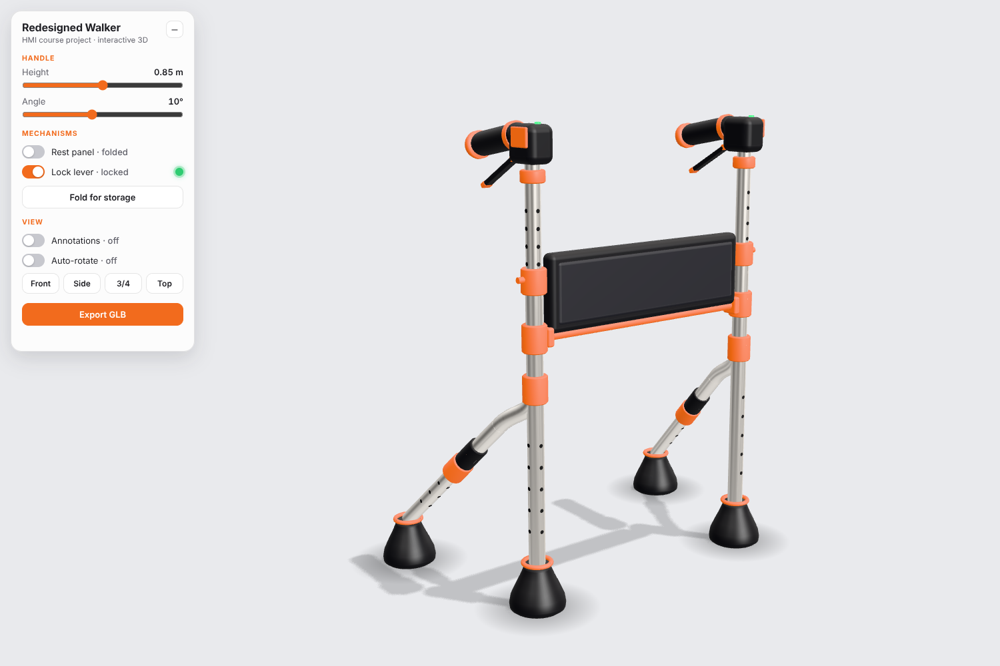

# Redesigned Walker: interactive 3D model

A Vite + three.js model of the redesigned walker from the HMI course product sheet (the large centre render).
Everything is built from code primitives in real-world metres; there are no external models and no 3D libraries
besides `three` and its bundled addons.



## Run it

```bash
cd walker-3d
npm install
npm run dev        # http://localhost:5173
```

Other scripts: `npm run build` (production bundle in `dist/`) and `npm run preview`.

## Controls (top-left panel)

| Control | What it does |
| :--- | :--- |
| Handle height | 0.75 to 0.95 m. The upper tube telescopes out of the lower tube; the handle and its lock lever travel with it. |
| Handle angle | Tilts the grip (and the lever under it) about the mount, -5° to 30°. |
| Rest panel | Eased fold / unfold. Folded is flush and vertical; unfolded the hinge rotates 90° into a horizontal perch toward the user. |
| Lock lever | Push down = locked, pull up = released. The indicator on the handle and in the panel turns green when locked. |
| Fold for storage | The side frames slide together, the rear legs tuck inward and the rest panel narrows with them. The perch stows first. Press again to unfold. |
| Annotations | CSS2D labels with leader lines for the handle, control interface, rest panel, height-adjustment lock and non-slip feet. Labels stay clamped to the viewport and clear of the panel. |
| Front / Side / 3/4 / Top | Smooth camera tween, framed to the viewport size. Dragging the model cancels the tween. |
| Export GLB | Downloads the walker in its current pose with `GLTFExporter` (helper objects such as contact shadows and anchors are left out). |
| Auto-rotate | Slow turntable for presentations. |
| Start walkthrough | Guided tour of the five steps on the product sheet: standing up from a chair, walking, turning, resting on the panel, folding. A mannequin uses the walker; Back, Next, Pause, the numbered dots, the arrow keys and Esc all work. |
| Redesigned / Existing / Compare | Switches between the redesigned walker, the walker it replaces, and a draggable wipe (existing on the left, redesigned on the right) with the sheet's problem and benefit lists. |
| User and fit | Enter a height from 140 to 200 cm. The mannequin stands at the walker and the elbow bend at the grips is measured live: 15° to 35° is a good fit. "Fit handle to this height" sets the handle to about half of standing height. The existing walker's fixed handle shows where it stops fitting. |

Orbit with the mouse or touch (drag, scroll or pinch).

## Dimensions

| | |
| :--- | :--- |
| Handle height | 0.75 to 0.95 m (default 0.85 m) |
| Width between side frames | 0.50 m (centre line to centre line); 0.13 m folded |
| Depth | about 0.45 m including the feet |
| Tube radius | 0.015 m (0.0135 m for the sliding tubes) |

All of these live in `src/constants.js`.

## Code layout

```
src/
  main.js         wiring, animation loop, UI actions
  scene.js        renderer, camera, OrbitControls, RoomEnvironment, key light, shadow-catching ground
  walker.js       assembles the two frames and the panel; apply(state) poses the whole model
  frame.js        createSideFrame(side): upright, telescoping tube, rear leg, collars, adjustment holes
  handle.js       createHandle(side): mount, grip, orange end cap, lock lever, indicator
  panel.js        createPanel(): padded RoundedBox, orange hinge, fold/unfold pivot
  foot.js         createFoot(): LatheGeometry rubber foot with an orange ring
  controls.js     the DOM control panel
  walkthrough.js  the five guided steps and their caption card
  mannequin.js    art mannequin with two-bone IK for arms and legs
  poses.js        standing pose shared by the tour and the fit check
  ergonomics.js   recommended handle height and the fit rating
  existing.js     the fixed-height walker being replaced
  compare.js      wipe divider and the before/after lists
  props.js        chair and floor ticks for the tour
  annotations.js  CSS2D labels and leader lines
  cameraRig.js    camera presets and tween
  exporter.js     GLB export
  materials.js    aluminium, black, orange, rubber
  geometry.js     tube, collar and hole helpers, contact-shadow blob
  tween.js        eased tweens
  constants.js    dimensions, colours, default state
```

Each part is a function that returns a `THREE.Group` with its pivot at the joint it rotates about. The animated state
(`handleHeight`, `handleAngle`, `panelOpen`, `lock`, `fold`) is a plain object that `walker.apply()` reads every frame,
so animation (`tween.js`) stays outside the model.

## Notes

- Materials: aluminium is `MeshStandardMaterial` with metalness 0.9 and roughness 0.3 plus a fine brushed roughness map;
  black parts use roughness 0.6; the accent orange is `#F26B1D`.
- Lighting: `RoomEnvironment` image-based light, one soft key light with a shadow map, a ground plane that only
  draws shadows, and a radial contact blob under each foot.
- Pixel ratio is capped at 2 and antialiasing is on. The render loop uses `renderer.setAnimationLoop`.
- The fold is a parallel slide with the rear legs tucking in, not a pure swing about a vertical hinge: with
  two mirrored frames, a swing would make the frames cross each other.
- `window.walkerDebug` exposes the state and camera rig for console experiments and automated screenshots.

## three.js skills used

While building this I installed the [CloudAI-X/threejs-skills](https://github.com/CloudAI-X/threejs-skills) bundle
(fundamentals, geometry, materials, lighting, interaction, animation, asset pipeline, performance) and followed its
r186 guidance: `three/addons/` import paths, `PCFShadowMap` (not the deprecated soft variant), `THREE.Timer` plus
`setAnimationLoop`, and `scene.environmentIntensity` instead of per-material `envMapIntensity`.
